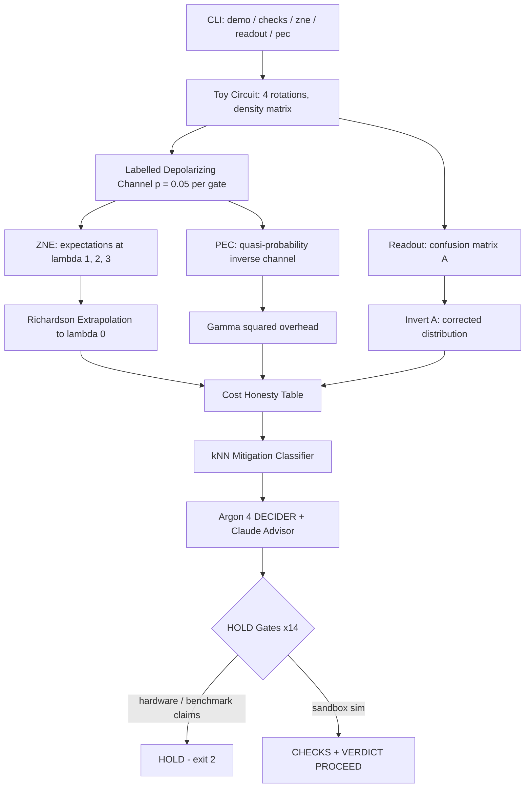
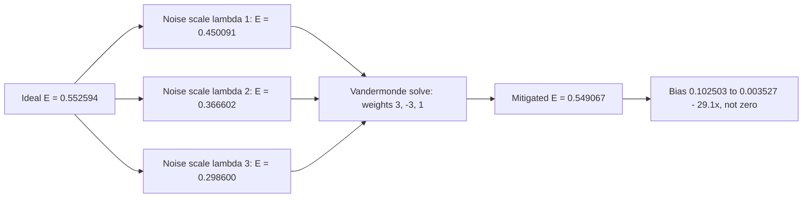
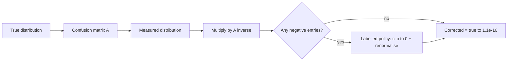
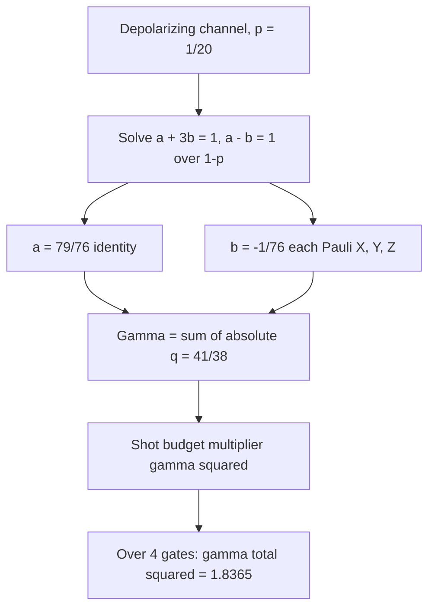
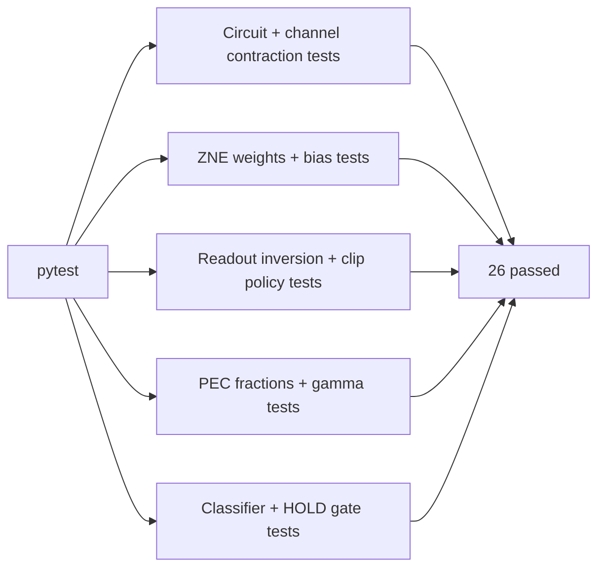
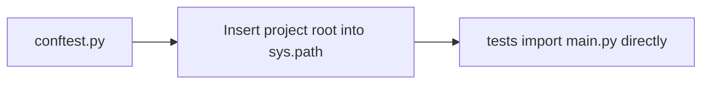
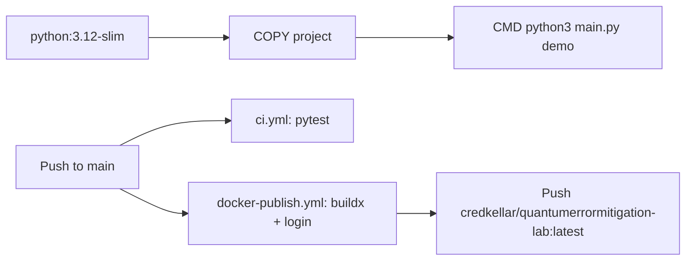

# QuantumErrorMitigation-Lab 🧹⚛️

**Quantum Error Mitigation Lab** — by Darion Kellar

QuantumErrorMitigation-Lab is an **educational quantum error mitigation lab** in ONE pure-Python file. It takes a toy one-qubit circuit, corrupts it with a **labelled depolarizing channel**, and then does the three classic mitigation moves with exact arithmetic: **zero-noise extrapolation** (run at noise scales λ = 1, 2, 3, Richardson-extrapolate back to λ = 0), **readout mitigation** (invert a labelled confusion matrix), and **probabilistic error cancellation** (the inverse channel as an exact quasi-probability mixture, with its γ² price tag attached).

The honest scope is the whole point, and it is stated everywhere:

- ✅ **What it shows:** the mitigation arithmetic itself, exactly — expectations, extrapolation weights, matrix inverses, quasi-probability coefficients, and the cost of each move, all computed in the open and asserted in CHECKS.
- 🚫 **What it can never show:** a hardware result. No quantum device was run, no real calibration was used, and a mitigated value here is an **estimate on a toy model** — never a measurement, and never evidence that mitigation beats error correction. It doesn't: mitigation trades bias for variance, and this lab prints the bill next to every mitigated number.

Every hardware / production / benchmark / vendor use sits behind a permanent HOLD gate (14 total). 🔒

[](https://github.com/kimanicollier44-cmyk/QuantumErrorMitigation-Lab/actions/workflows/ci.yml)
[](https://github.com/kimanicollier44-cmyk/QuantumErrorMitigation-Lab/actions/workflows/docker-publish.yml)

> ℹ️ These are the **live** workflow badges for this repo. They activate as soon as the `ci.yml` and `docker-publish.yml` files from the paste pack are pasted into `.github/workflows/` — until then they have nothing to report yet.

## 🧰 Tech Stack Badges & Full Architecture Tech Stack

### 💻 Core Programming Languages & Core Systems


- 🐍 Python 3.12, pure standard library (`math`, `fractions`, `hashlib`, `json`, `sys`) — zero dependencies, zero network, deterministic (double-run byte-identical)
- 🧮 Density matrices from scratch: 2×2 complex arithmetic written out by hand (multiply, dagger, trace, purity) — no numpy, so every expectation can be read and diffed
- 🎲 Exact quasi-probability arithmetic: PEC coefficients are `Fraction`s (a = 79/76, b = −1/76), asserted digit for digit, never rounded into a claim
- 🧠 TinyML kNN mitigation classifier (from scratch, stdlib): mitigate-with-ZNE / readout-only / too-noisy-to-trust from (raw bias, noise strength, γ² total), labels generated by the lab's own verdict policy
- 🪑 Council seats: Gemini Argon 4 DECIDER (names-only, tighten-only) + Muse advisor (never overrides HOLD) + Google Flow plan-only (rendered = False, live = 0)

### ⛓️ Web3 & Infrastructure

- 🚫 **Not applicable — honestly.** No blockchain, no Web3, no tokens: the "infrastructure" in this lab is a labelled noise channel and three mitigation formulas inside one offline file. No fake badges here.

### ⚙️ Platform Support & Hardware Architecture


- 🖥️ Pure Python — runs anywhere Python 3.12+ runs (Linux, macOS, Windows), plus the `python:3.12-slim` Docker image
- 🔒 No quantum hardware is touched, ever: real devices, real calibrations, and hardware result claims are permanent HOLD gates (see the gate table below)

### ⚡ Low-Level Infrastructure & Performance

- 🚫 **No low-level code — honestly.** No C, no C++, no GPU, no compiled extensions: this is one interpreted Python file on purpose, so every matrix entry, extrapolation weight, and quasi-probability coefficient can be read, checked, and diffed. Performance here means honest algorithms — a from-scratch Vandermonde solve for the Richardson weights and exact rational arithmetic for PEC — all deterministic and byte-identical between runs.

### 🛠️ DevOps & Build Tools


- 🐳 Docker (`python:3.12-slim`), GitHub Actions CI + Docker Publish (delivered in the paste pack)
- 🎯 Target image: `credkellar/quantumerrormitigation-lab:latest`
- 🧪 Tests: `pytest` (26 tests) + the built-in CHECKS suite (48 checks) in `main.py`

### ☁️ Cloud Providers

- 🚫 **None — honestly.** No cloud provider is used or needed: the lab runs fully offline on your own machine or in a local Docker container. Docker Hub appears only as the registry the publish workflow pushes the image to.

## What this does?

1. 🎛️ **A toy circuit with an honest expectation** — four rotations (Ry π/3, Rx π/5, Rz π/4, Rx π/6) on one qubit, run as an exact density matrix. The noiseless answer is **⟨Z⟩ = +0.552594**, computed by the matrix code — and a one-gate control case (Ry π/3 alone) is asserted against cos(π/3) = 0.5 in CHECKS, so the machinery is pinned to a known value before any noise shows up.
2. 📉 **Labelled depolarizing noise** — after every gate, a depolarizing channel with **p = 0.05** (a labelled teaching value, not a device spec) mixes the state toward the maximally mixed state. Because the channel contracts every Bloch component by exactly (1 − p), the noisy expectation obeys **E(λ) = 0.95^(4λ) · E_ideal exactly** — a scaling law the checks assert to 1e-12, not a fit.
3. 🔭 **Noise scaling for ZNE** — the noise is amplified by scaling the per-gate strength to p_λ = 1 − (1 − p)^λ, the single channel with the same contraction as λ repeats (the arithmetic shadow of circuit folding). At λ = 1, 2, 3 the expectations are **+0.450091, +0.366602, +0.298600** — the raw λ = 1 value already carries a bias of **0.102503**.
4. 📐 **Richardson extrapolation** — the weights for nodes 1, 2, 3 are solved from the Vandermonde system by from-scratch Gaussian elimination and come out at exactly **(3, −3, 1)**. Applied to the noisy points they give **+0.549067** — the bias falls from 0.102503 to **0.003527, a 29.1× cut**.
5. ⚠️ **The leftover bias stays on the page** — the true E(λ) is an exponential and Richardson assumes a polynomial, so the mitigated value is *not* exact, and the lab refuses to pretend otherwise: CHECKS assert the mitigated error is **strictly greater than 1e-6** as well as strictly smaller than the raw error. An extrapolation that lands exactly on the ideal would be a red flag, not a triumph.
6. 🔀 **Readout mitigation by inversion** — a labelled confusion matrix A (P(1|0) = 0.03, P(0|1) = 0.07) tilts the true distribution (0.776297, 0.223703) into the measured (0.768667, 0.231333); multiplying by A⁻¹ recovers the true distribution with error **1.11e-16** — exact, because this step is pure classical linear algebra on the stated matrix.
7. 🕳️ **The negative-probability trap, handled in the open** — a labelled measured vector (0.972, 0.028) inverts to (1.002222, **−0.002222**): matrix inversion does not know probabilities must be positive. The lab's labelled policy — clip negatives to zero, renormalise — returns (1.0, 0.0), and the policy is named wherever it is used instead of being smuggled in.
8. 🎰 **PEC: the inverse channel as a quasi-probability mixture** — for the same labelled depolarizing channel, the inverse is E⁻¹ = a·id + b·(X· + Y· + Z·) with the derivation printed in the code: **a = 79/76, b = −1/76** as exact fractions. Applied after the channel, the mixture restores a test state to **1.11e-16** — unbiased on paper, exactly as advertised.
9. 🧾 **The bill, itemised** — PEC's γ = Σ|qᵢ| = 41/38 per gate means a **γ² = 1.164127** shot multiplier per gate, compounding to **γ_total² = 1.8365** over this 4-gate circuit. ZNE's weights amplify statistical error by Σ|w| = 7, a **×49 variance** factor. Readout inversion amplifies noise by up to **×1.1111**. Every mitigated number in the demo is printed next to its price.
10. 🏷️ **Verdict classifier + seats + checks** — a from-scratch kNN reads (raw bias, noise strength, γ² total) and issues the lab-policy verdict: this demo circuit → **mitigate-with-ZNE**; a tiny-bias gentle case → **readout-only**; heavy noise or a huge γ² → **too-noisy-to-trust**. Watched over by the Argon 4 DECIDER (sha256 trace), Muse advisor, Google Flow plan-only, and a built-in CHECKS suite (48 checks).

## 🗺️ How it works — diagram per script

### `main.py` — the whole lab



### `main.py` § Zero-noise extrapolation



### `main.py` § Readout mitigation



### `main.py` § Probabilistic error cancellation



### `tests/test_main.py` — verification



### `conftest.py` — test path setup



### `Dockerfile` + CI flow — container & publish



## Why is this cool?

1. 📐 The Richardson weights are **solved, not quoted**: a from-scratch Gaussian elimination on the Vandermonde system produces (3, −3, 1), and the test suite checks them digit by digit.
2. 📉 The noise law is **exact, not fitted**: a depolarizing channel contracts the Bloch vector by (1 − p) per gate, so E(λ) = 0.95^(4λ) · E_ideal holds to 1e-12 — the extrapolation starts from a law, not a hope.
3. 🎯 A **29.1× bias cut with the remainder printed**: 0.102503 → 0.003527, and the surviving 0.003527 is displayed as a first-class result. Mitigation that hides its leftover error is marketing; this is arithmetic.
4. 🧪 The checks **assert imperfection**: `zne_mitigated_not_exact` fails the build if the extrapolated value ever lands within 1e-6 of ideal — the lab tests its own honesty.
5. 🎰 PEC coefficients are **exact fractions** — a = 79/76, b = −1/76 — derived in the open from two linear equations, so γ = 41/38 is a rational number you can verify by hand.
6. 🕳️ The negative-probability failure of readout inversion is **demonstrated, not footnoted**: a real inversion in the demo returns −0.002222, and the clip policy that fixes it is labelled as a policy.
7. 🧾 Every technique ships with its **invoice**: ZNE ×49 variance, PEC γ_total² = 1.8365 shots, readout ×1.1111 noise amplification — the cost table is a demo section, not an appendix.
8. 🔀 Readout mitigation recovers the true distribution to **1.11e-16** — a reminder that the classical post-processing step can be exact even when the quantum step cannot.
9. 🏷️ The classifier knows when to **give up**: past p ≥ 0.15 or γ² ≥ 4 the verdict is too-noisy-to-trust — the most useful answer a mitigation lab can give is sometimes "don't".
10. 🎯 Deterministic end to end: run it twice, get byte-identical output — error mitigation you can diff.

## What problems this solves?

1. ❌ **Problem:** "Error mitigation" and "error correction" are used interchangeably in popular writing. ✅ **Solution:** The distinction is the lab's first section and a permanent HOLD gate — mitigation estimates, correction protects, and the code never blurs them.
2. ❌ **Problem:** ZNE is usually shown as three points and a confident arrow to zero noise. ✅ **Solution:** The weights are derived, the exponential-vs-polynomial mismatch is named, and the leftover bias (0.003527) is printed and asserted nonzero.
3. ❌ **Problem:** Noise scaling is described vaguely as "run it noisier". ✅ **Solution:** The scaling method is stated exactly — p_λ = 1 − (1 − p)^λ, the contraction of λ channel repeats — and the resulting scaling law is verified to 1e-12.
4. ❌ **Problem:** Readout mitigation is presented as a free undo button. ✅ **Solution:** The inversion is shown exactly, including where it breaks (negative probabilities) and the labelled clip policy that repairs it at the price of a little bias.
5. ❌ **Problem:** PEC's overhead is quoted as "γ²" without anyone computing γ. ✅ **Solution:** γ is computed from exact rational coefficients — 41/38 per gate, 1.8365 total γ² for this circuit — with the derivation in the docstring.
6. ❌ **Problem:** Mitigated results get reported without their raw partners. ✅ **Solution:** The `suppress_raw_data` HOLD gate makes the pairing permanent: raw and mitigated values travel together in every report this lab prints.
7. ❌ **Problem:** Extrapolated values get quoted as if they were measured. ✅ **Solution:** The `extrapolation_as_measurement_claim` gate, plus demo language that calls the λ = 0 value an estimate every single time.
8. ❌ **Problem:** Toy noise models quietly become "device benchmarks". ✅ **Solution:** Every channel parameter is labelled a teaching value, and hardware / benchmark / vendor claims are three separate HOLD gates.
9. ❌ **Problem:** Nobody says when mitigation is hopeless. ✅ **Solution:** The verdict policy has an explicit too-noisy-to-trust region (p ≥ 0.15 or γ² ≥ 4), and the classifier is trained on the policy, not on optimism.
10. ❌ **Problem:** Simulation tools quietly imply a service is next. ✅ **Solution:** 14 named HOLD gates return exit code 2 for every hardware, production, financial, scientific-publication, or defense claim, forever.

## How to install this?

1. 📋 Clone or download this project folder.
2. 🐍 Make sure Python 3.12+ is installed: `python3 --version`
3. ▶️ Run the full demo + checks (no arguments needed):

```bash
python3 main.py
```

4. 🧪 Run the test suite:

```bash
pip install pytest
python3 -m pytest -q
```

5. 🎛️ Try the other commands:

```bash
python3 main.py checks    # 48 built-in checks
python3 main.py circuit   # gates, ideal + noisy expectations (JSON)
python3 main.py zne       # Richardson weights, raw vs mitigated errors
python3 main.py readout   # confusion inversion + negative case + clip policy
python3 main.py pec       # exact coefficients, gamma, gamma^2 overhead
python3 main.py costs     # the bill: variance x49, gamma^2, amplification
python3 main.py classify  # kNN mitigation verdict report
python3 main.py brains    # Argon 4 + Muse + Flow seats
python3 main.py holds     # list all 14 HOLD gates
python3 main.py hold-demo # exits 2 - gated actions stay HOLD
```

6. 🐳 Or run it in Docker:

```bash
docker build -t credkellar/quantumerrormitigation-lab:latest .
docker run --rm credkellar/quantumerrormitigation-lab:latest
```

## Requirements

- 🐍 Python 3.12 or newer
- 📦 Dependencies: **none** (standard library only)
- 🌐 Network: **none** — fully offline
- 🧪 For tests only: `pytest`
- 🐳 Optional: Docker

## FULL project structure tree

```text
quantumerrormitigation-lab/
├── main.py                  # the whole lab: density matrices, toy circuit, depolarizing channel, ZNE, readout inversion, PEC, cost table, classifier, seats, HOLD gates
├── conftest.py              # puts the project root on sys.path for tests
├── tests/
│   └── test_main.py         # 26 pytest tests: circuit, channel, ZNE, readout, PEC, costs, classifier, gates, determinism
├── assets/
│   └── cover.png            # README cover image (2736 x 912)
├── Dockerfile               # python:3.12-slim, runs the demo
├── .gitignore               # __pycache__/, .pytest_cache/, *.pyc
└── README.md                # this file
```

> 📦 Delivered separately as paste packs (not in this tree): `.github/workflows/ci.yml` + `docker-publish.yml`, and the Docker Hub pack (100-char description, 350-char About, overview, categories).

## 🔒 HOLD gates — all 14, permanent

| # | Gate | What stays held |
|---|------|-----------------|
| 1 | `hardware_result_claim` | No claim of results on real quantum hardware; this lab ran no device |
| 2 | `mitigation_beats_error_correction_claim` | No claim that mitigation replaces or beats quantum error correction |
| 3 | `production_workload_use` | No production, paid, or operational workload decisions from this toy lab |
| 4 | `benchmark_superiority_claim` | No benchmark or superiority claims about any hardware or vendor |
| 5 | `error_free_result_claim` | A mitigated value is an estimate with error bars, never an exact or error-free result |
| 6 | `financial_decision_use` | No financial, trading, or investment decisions from mitigated toy numbers |
| 7 | `scientific_publication_claim` | No publishing this lab's toy output as scientific or medical evidence |
| 8 | `cryptographic_security_claim` | No cryptographic or security claims from toy noise models |
| 9 | `real_device_calibration_use` | The lab's confusion matrix is labelled teaching data, never a real device calibration |
| 10 | `guaranteed_accuracy_claim` | No guaranteed accuracy or precision claims for any mitigated value |
| 11 | `defense_classified_use` | No defense, classified, or weapons-related use of this lab |
| 12 | `suppress_raw_data` | Raw unmitigated values must always be shown next to mitigated ones |
| 13 | `extrapolation_as_measurement_claim` | The lambda=0 extrapolated value is an estimate, never a measurement |
| 14 | `vendor_comparison_claim` | No comparing real QPUs or vendors using this lab's toy channels |

🧑‍⚖️ **Council seats:** Gemini Argon 4 Extended Thinking — DECIDER (names-only, tighten-only, MAP → MODEL → STRESS → DECIDE, sha256 trace, `can_override_hold = False`) · Muse — advisor (`can_override_hold = False`) · Google Flow — plan-only (`rendered = False`, `live = 0`).

✅ **Verification:** pytest **26 passed** (project + clean copy) · built-in CHECKS **48/48** · double-run output **byte-identical** · `hold-demo` exits **2** · `main.py` **820 lines**, pure stdlib, zero network.

## 🧒 5th-grade English section

Imagine you take a photo on a foggy day. The photo is real, but the fog makes everything look faded and grey. 📷

- **Error mitigation** is like a photo editor for a quantum computer's answers. The quantum computer's answers come out a bit faded because of "noise" — like fog. The editor cannot take a new photo. It can only study the faded one and make a smart guess about the bright colours underneath. 🔆
- One trick: take the photo in **three amounts of fog** — a little, more, and even more. If you watch how the colours fade as the fog grows, you can draw the line backwards to **zero fog** and guess the true colour. That is zero-noise extrapolation. The guess is much better — but it is still a guess, and this lab shows you the little bit of wrongness that is left. 📐
- Another trick fixes the **camera's own mistakes**: if the camera sometimes calls dark blue "purple", you can write down how often it mixes colours up, and un-mix them with maths. Sometimes the un-mixing says "minus two percent purple" — a silly answer — so there is a rule: cross out the minus, fix the rest, and say out loud that you did it. 🔀
- The third trick costs **extra photos**. You mix in some deliberately wrong photos with minus signs in the maths, and the fog cancels out — but you need many more photos to get the same sharpness. The lab counts exactly how many more. 🎰
- None of this is the same as **error correction**, which is like having a spare camera that fixes the fog *while* you take the photo. Mitigation is the editor afterwards — helpful, honest about its price, and never magic. 💻

---

MIT © 2026 Darion Kellar · QuantumErrorMitigation-Lab — educational simulation only 🧹
